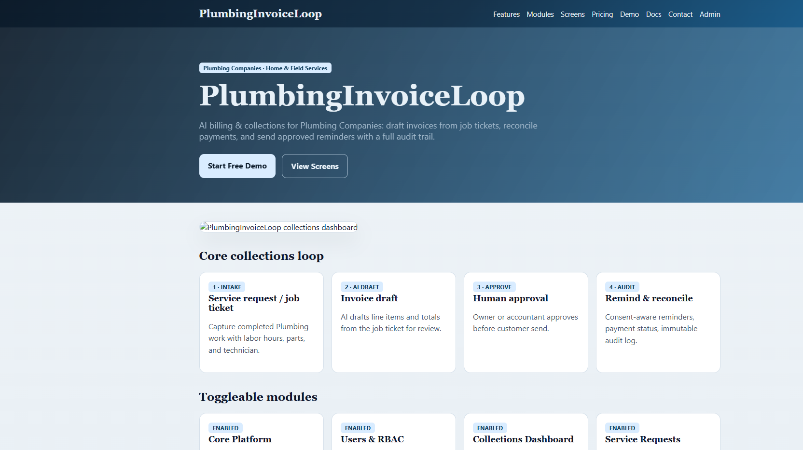
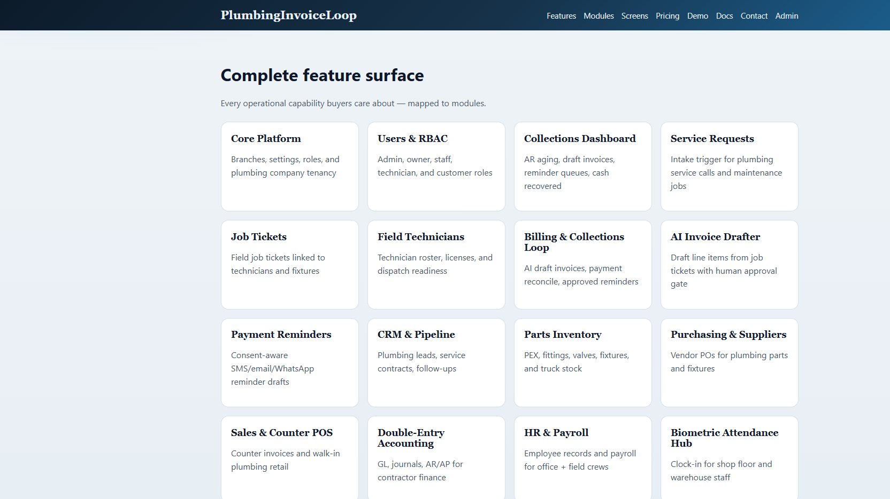
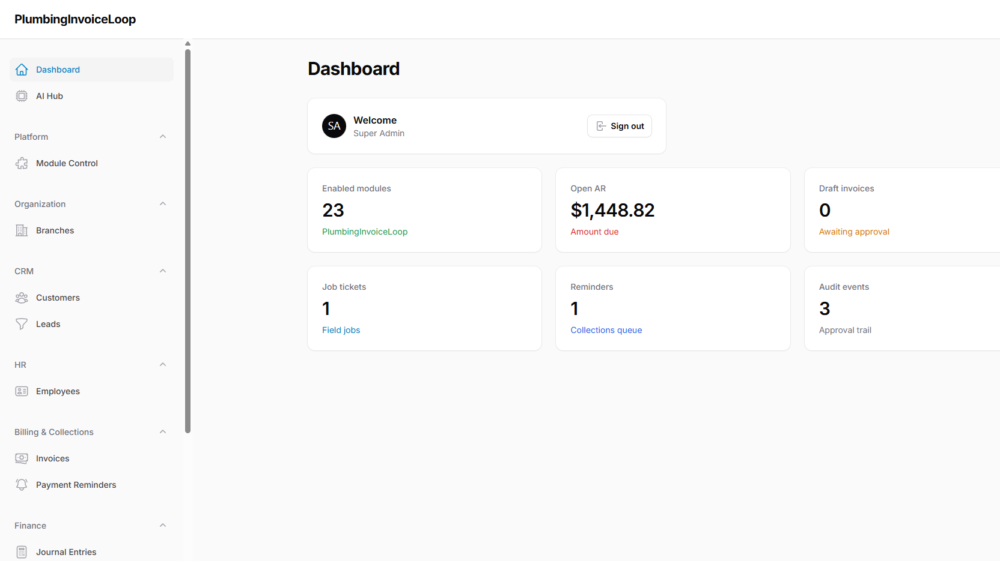
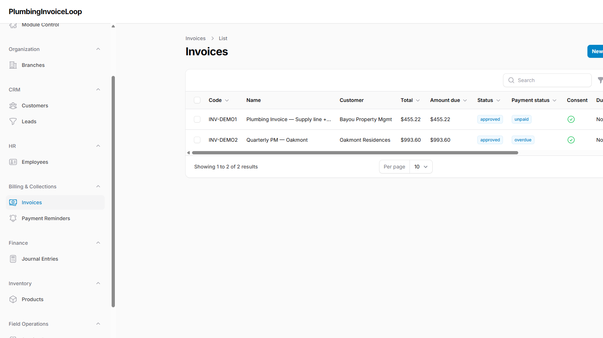

# PlumbingInvoiceLoop — AI Billing & Collections Assistant for Plumbing Companies (Laravel Filament SaaS)

**PlumbingInvoiceLoop** is a modular Laravel + Filament business automation platform for **Plumbing Companies** that drafts invoices from service jobs, reconciles payment status, and sends **human-approved** collection reminders — with a full audit trail.

> Rank #13 USA AI Business Automation Opportunity · Finance · Home & Field Services · Pilot **$199–$799/mo**

## Why Plumbing Owners buy this

Plumbing field work finishes on job tickets, but billing still lags: drafts sit in spreadsheets, payment status is unclear, and reminders go out without consent checks. PlumbingInvoiceLoop closes the loop:

1. **Intake** — service request / completed job ticket  
2. **AI draft** — invoice line items from labor + parts  
3. **Human approval** — owner / accountant gate  
4. **Audit log** — immutable record of draft → approve → remind → reconcile  

## Screenshots

| Home | Features / Modules | Admin dashboard | Invoices |
|------|--------------------|-----------------|----------|
|  |  |  |  |

## Core modules (toggle ON/OFF)

| Module | Default | Purpose |
|--------|---------|---------|
| Billing & Collections Loop | ON | Draft → approve → remind → reconcile |
| AI Invoice Drafter | ON | Job ticket → invoice draft |
| Payment Reminders | ON | Consent-aware reminder queue |
| Service Requests | ON | Intake trigger |
| Job Tickets | ON | Field work + labor/parts |
| Field Technicians | ON | Roster & licenses |
| Collections Dashboard | ON | Open AR / drafts / reminders |
| Audit & Approval Log | ON | Maker-checker trail |
| CRM, Inventory, Accounting | ON/optional | Supporting ops |
| Purchasing, POS, HR, Ecommerce | OFF | Enable when needed |
| Jobber / ServiceTitan / QuickBooks / Google Calendar | ON | Integration stubs |
| AI Hub, Unicode PDF, Drutogoti, Attendance Hub | Mixed | Packagist-powered accelerators |

## Multi-user roles

| Role | Demo email | Password |
|------|------------|----------|
| Super Admin | `admin@demo.local` | `password` |
| Plumbing Owner | `owner@demo.local` | `password` |
| Operations Lead | `manager@demo.local` | `password` |
| Billing Accountant | `accounts@demo.local` | `password` |
| Office Staff | `staff@demo.local` | `password` |
| Field Technician | `tech@demo.local` | `password` |
| Customer Portal | `customer@demo.local` | `password` |

Admin panel: `/admin`

## Docker quick start

```bash
docker compose up -d --build
```

- App: [http://localhost:8113](http://localhost:8113)  
- Admin: [http://localhost:8113/admin](http://localhost:8113/admin)  
- MySQL host port: `33073` (container `3306`)  
- Redis host port: `63803` (container `6379`)

Entrypoint runs migrations + demo seed automatically.

## Local (non-Docker)

```bash
composer install
cp .env.example .env
php artisan key:generate
php artisan migrate --seed
php artisan serve --port=8113
```

## Tech stack

- PHP 8.4 · Laravel 12 · Filament 3 · Livewire 3  
- MySQL 8.4 · Redis-ready queue/cache drivers  
- Spatie Permission · Laravel Sanctum  
- Prefer Packagist packages when available:  
  `imrandevbd/drutogoti`, `laravel-admin-panel`, `laravel-ai-catalog`, `laravel-ai-hub`, `laravel-attendance-hub`, `laravel-unicode-pdf`, `laravel-universal-slug`  
- Docker Compose (Apache + MySQL)

## SEO / related keywords

Plumbing contractor software, plumbing company billing software, plumbing invoicing, accounts receivable automation, collections assistant, payment reminders, job ticket billing, service request management, field technician dispatch finance, drain cleaning invoicing, water heater install billing, repipe project invoices, leak repair collections, preventive maintenance contracts, QuickBooks plumbing, ServiceTitan alternative billing, Jobber invoice sync, Google Calendar field service, AI invoice draft, Laravel Filament SaaS, modular ERP, consent-aware SMS email WhatsApp reminders, AR aging reports, plumbing compliance licensing, code inspection documentation hooks, multi-branch plumbing ops, contractor finance automation, USA field services SaaS 2026, PlumbingInvoiceLoop.

## Integrations (MVP hooks)

Jobber · ServiceTitan · QuickBooks · Google Calendar

## Risk / compliance note

MED — messaging consent, licensing and safety. Reminders require consent flags before send.

## MVP workflow shipped

`1 intake trigger → AI draft/action → human approval → audit log`

## Public marketing pages

`/` · `/features` · `/modules` · `/screens` · `/pricing` · `/demo` · `/docs` · `/contact`

## Author

Built by **Imran Ahmed** only. No GitHub Actions workflows are included.

## Contact / Hire

- Developer: Imran Ahmed (IMRAN Dev BD)
- Website: https://imrandev.bd/contact
- Email: me@imrandev.bd
- GitHub: https://github.com/imranbru99
